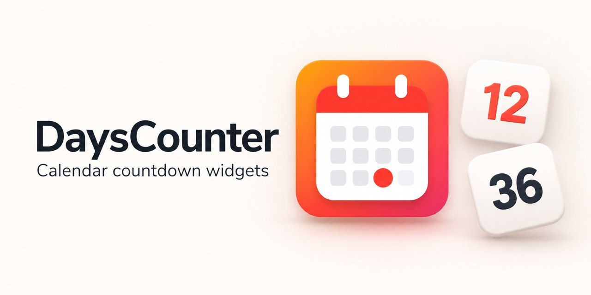
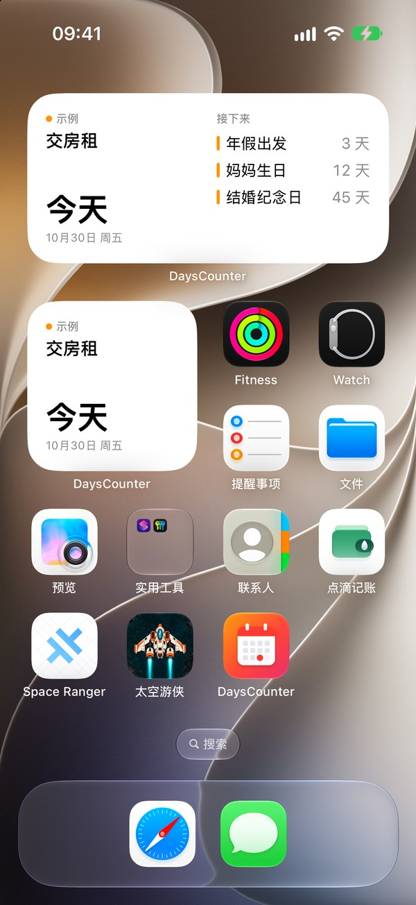
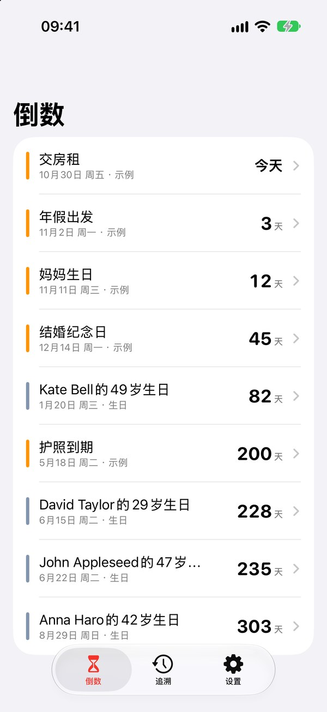
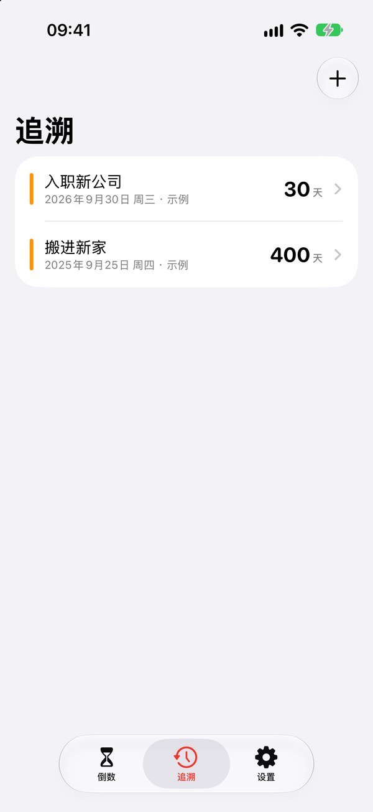

# DaysCounter

[](https://github.com/nervouna/dayscounter/releases/latest)


[](LICENSE)



An iOS and macOS app with widgets that count down to the next all-day event in your calendars, and count up from past all-day events you pin. It reads your calendars and never changes them.

| Widgets | 倒数 (Countdown) | 追溯 (Since) |
| --- | --- | --- |
|  |  |  |

## Status

DaysCounter is a personal project, built for its author's own calendars. It is early: there is no App Store or TestFlight build, and builds come from source. Running it takes a Mac with Xcode 27, iOS 26 or macOS 26, and an Apple developer account to sign the app and its widget. The interface is in Chinese. The maintainer plans a source-only v0.1.0 release; until then, build from `main`.

See [CONTRIBUTING.md](CONTRIBUTING.md) to report a bug or send a fix, and [SECURITY.md](SECURITY.md) for security problems.

## What it does

The app has three sections: 倒数 (Countdown), 追溯 (Since) and 设置 (Settings). On macOS, Settings is in the app menu instead of a tab.

- **倒数 (Countdown)** lists all-day events in the next year from the selected calendars, soonest first, with the days left.
- **追溯 (Since)** lists past all-day events you pinned, with the days since each. Tap 添加 (Add) to pick one from the last ten years; swipe or use 取消追溯 (Unpin) to remove it.
- **重要日历 (Calendars)**, under Settings, chooses which calendars count. Only all-day events count. Subscribed calendars, such as public holidays, are left out until you turn them on.

Widgets:

- **倒数日 (Countdown)**: the next all-day event from the selected calendars. Small and medium; on iOS also the lock screen circular, rectangular and inline sizes.
- **追溯 (Since)**: days since one pinned event, chosen in the widget's settings. Small; on iOS also the lock screen sizes.

Tapping a widget opens the event in the app.

## Permissions and privacy

DaysCounter asks for full access to your calendars, which it uses read-only to find all-day events. If access is off, the app shows 打开系统设置 (Open System Settings) so you can turn it on under Privacy › Calendars.

The app makes no network requests. The calendar selection and the pinned events (title, date and calendar of each) are stored in the App Group shared by the app and its widget, on your device only.

## Install

There are no prebuilt downloads. Build it with Xcode as described under [Build](#build). To run it on your own device, set `DEVELOPMENT_TEAM` in `project.yml` to your team, and change `bundleIdPrefix` and the App Group ID (`group.io.damao.DaysCounter`, in `project.yml` and `SharedStore.swift`) to identifiers your team can register.

To remove it, delete the app. On iOS its widgets and stored settings go with it. On macOS, also delete the App Group folder `~/Library/Group Containers/group.io.damao.DaysCounter`.

## Development

Requires Xcode 27. The deployment target is iOS 26 and macOS 26.

### Layout

| Path | Contents |
| --- | --- |
| `project.yml` | XcodeGen spec; `DaysCounter.xcodeproj` is generated from it and not checked in |
| `App/` | SwiftUI app (shared by iOS and macOS) |
| `Widget/` | WidgetKit extension |
| `Packages/DaysCounterKit/` | Shared logic: day math, EventKit queries, App Group store, deep links |

The app and widget share settings and pinned events through the App Group `group.io.damao.DaysCounter`. The widget reads EventKit itself using the app's calendar permission.

### Build

```bash
brew install xcodegen
xcodegen generate
open DaysCounter.xcodeproj
```

Command line:

```bash
xcodebuild -project DaysCounter.xcodeproj -scheme DaysCounter -destination 'platform=macOS' -allowProvisioningUpdates build
```

Tests (logic only, run on macOS):

```bash
cd Packages/DaysCounterKit && swift test
```

### Simulator demo data

Debug builds on the simulator accept `-seedDemoEvents`, which creates a "示例" calendar with sample all-day events when calendar access is already granted:

```bash
xcrun simctl privacy booted grant calendar io.damao.DaysCounter
xcrun simctl launch booted io.damao.DaysCounter -seedDemoEvents
```

## License

MIT. See [LICENSE](LICENSE).
